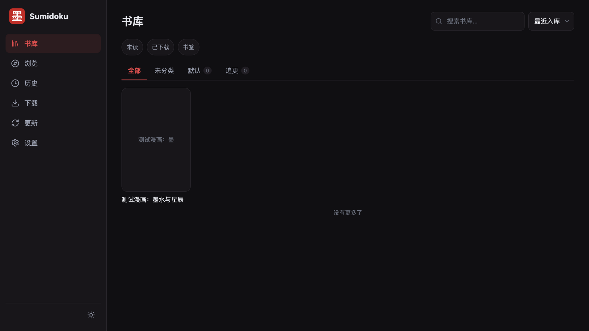
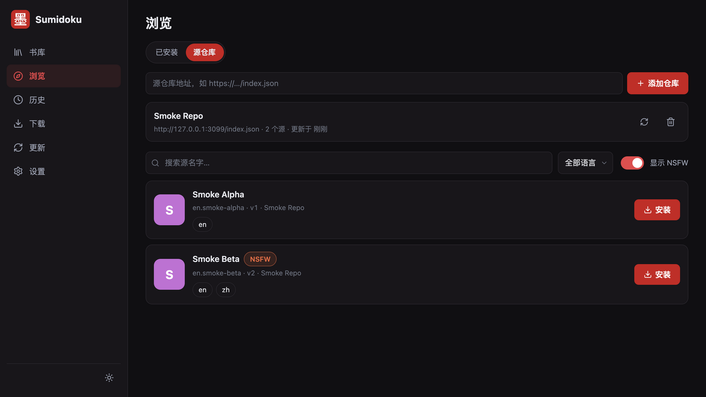

# Sumidoku

[](https://github.com/Sumidoku/Sumidoku/actions/workflows/ci.yml)
[](https://github.com/Sumidoku/Sumidoku/releases)
[](https://hub.docker.com/r/sumidoku/sumidoku)
[](LICENSE)

Self-hosted manga server: Aidoku WASM sources, REST + OPDS API, shipped as a single binary or a Docker image.




## Features

- **Aidoku WASM sources** — run source packages from any Aidoku-compatible
  repository: listings, search, filters, source home pages, settings,
  JavaScript execution, canvas drawing, and partial-result streaming all
  work server-side.
- **Source repositories** — add Aidoku-style source repos, browse with
  language/NSFW filters, one-click install and update (per-source or all).
- **Library and reading** — categories, reading progress, history,
  chapter downloads, scheduled library updates, and OPDS 1.2 + 2.0
  catalogs for KOReader and other readers.
- **Cloudflare bypass** — an optional [trawl](https://github.com/germondai/trawl)
  sidecar retries challenged requests and reuses the clearance.
- **Real-browser login** — an optional Chromium sidecar (driven over CDP)
  backs webview login flows, cookies landing in the source's session.
- **Authentication** — one site password guards the web UI, REST API and
  OPDS (off by default); session tokens and long-lived API keys.
- **Backup and migration** — versioned JSON backup, scheduled backups with
  retention, and imports from Aidoku (`.aib`) and Suwayomi/Mihon
  (`.tachibk`, `.proto.gz`).

## Quick start

```sh
docker compose up -d
```

The compose file pulls the published `sumidoku/sumidoku:latest` image and mounts `./config` and `./downloads`. Open http://localhost:3000. The same image is published to GitHub Container Registry as `ghcr.io/sumidoku/sumidoku`; point the compose `image:` at either.

## Volumes and environment

| Volume | Purpose |
| --- | --- |
| `/config` | database, settings, cover cache, source packages |
| `/downloads` | downloaded chapters |

| Variable | Default | Purpose |
| --- | --- | --- |
| `SUMIDOKU_ADDR` | `0.0.0.0:3000` | listen address |
| `SUMIDOKU_CONFIG_DIR` | `/config` | data root: database, covers and sources live under it |
| `SUMIDOKU_DOWNLOADS_DIR` | `/downloads` | downloads directory |
| `SUMIDOKU_COVERS_DIR` | `/config/covers` | cover cache directory |
| `SUMIDOKU_NET_TRAWL_PROXY` | — | trawl forward-proxy URL; enables Cloudflare-bypass retries |
| `SUMIDOKU_NET_TRAWL_CA` | — | trawl's MITM root CA (PEM); required for HTTPS sources through trawl |
| `SUMIDOKU_NET_RELAY_DOMAINS` | — | comma-separated domains always fetched through trawl |
| `SUMIDOKU_NET_BROWSER_WS` | — | Chromium CDP websocket URL; enables real-browser webview for source login flows |
| `SUMIDOKU_AUTH_PASSWORD` | — | site password; enables authentication for the web UI, REST API and OPDS |
| `SUMIDOKU_AUTH_API_KEYS` | — | comma-separated long-lived API keys; usable as `Authorization: Bearer <key>` |
| `SUMIDOKU_BASIC_PASSWORD` | — | legacy alias of `SUMIDOKU_AUTH_PASSWORD`; only applies when the latter is unset |
| `SUMIDOKU_BACKUP_ENABLED` | — | force scheduled backups on/off, overriding the `backup.enabled` setting |
| `SUMIDOKU_BACKUP_INTERVAL_HOURS` | — | override the `backup.interval_hours` setting (default 24) |
| `SUMIDOKU_BACKUP_RETENTION_COUNT` | — | override the `backup.retention_count` setting (default 10) |
| `SUMIDOKU_BACKUP_DIR` | `<config>/backups` | scheduled-backup destination, overriding the `backup.dir` setting; may live outside the config dir |

## Installing sources

Drop `.aix` source packages (or extracted source directories) into `./config/sources`, then press the scan button on the web UI's browse page, or call:

```sh
curl -X POST http://localhost:3000/api/v1/sources/scan
```

You can also add an Aidoku-compatible source repository from the browse page and install sources from it directly.

## OPDS

The OPDS 1.2 catalog is served at `/opds/v1.2` (OPDS 2.0 at `/opds/v2`). When authentication is enabled, the catalogs require Basic auth with the site password (any non-empty username); see [docs/authentication.md](docs/authentication.md).

## Documentation

- [docs/authentication.md](docs/authentication.md) — the auth model, credentials, OPDS and token details
- [docs/sidecars.md](docs/sidecars.md) — trawl (Cloudflare bypass) and Chromium (webview login) setup
- [docs/backup.md](docs/backup.md) — backup format, scheduled backups, and the Aidoku/Suwayomi import paths
- [docs/architecture.md](docs/architecture.md) — the technical contract: API surface, WASM runtime, data flow

## Local build

The web UI is embedded into the binary at compile time, so it must be built first:

```sh
cd webui && npm ci && npm run build && cd ..
cargo build --release -p sumidoku-server
```

## Development

- `cargo test` — server test suite
- `cd webui && npm run dev` — Vite dev server, proxying API calls to the server on :3000

## Contributing

Issues and pull requests are welcome. The project is built and maintained by agent sessions — [AGENTS.md](AGENTS.md) is the entry point for how that works, and [docs/contributors.md](docs/contributors.md) describes how community PRs are triaged and reviewed.

## License

MIT
