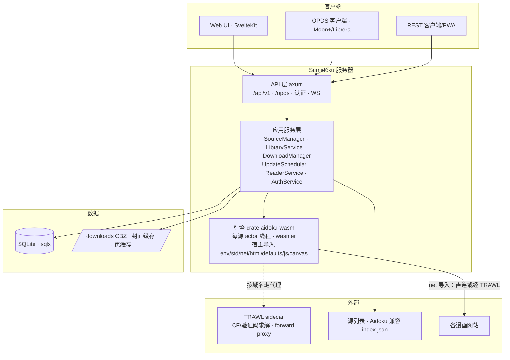

# Sumidoku（硯）— 自建漫画服务器设计文档

> 版本：v0.2 · 2026-10-17
> 状态：设计稿（v0.1 评审后重构，结论已对账三个参照项目源码）
> 一句话定位：一个 **Docker 自建漫画服务器**，以 Rust 原生加载并执行 Aidoku 的 WASM 源，对外提供 REST API、Web 阅读界面与 OPDS 协议，功能对齐 Suwayomi，内核用 Rust 替代 JVM、源生态用 Aidoku（WASM）替代 Tachiyomi 扩展（JVM）。

---

## 1. 项目概览

| 项    | 值                                          |
| ---- | ------------------------------------------ |
| 项目名  | **Sumidoku（硯）**                              |
| 形态   | Docker 自建服务（HTTP + Web UI + OPDS）          |
| 内核   | Rust（axum + tokio），wasmer 执行 Aidoku WASM 源 |
| 对标   | Suwayomi（服务端形态）+ Aidoku（源生态与宿主语义）      |
| 目标用户 | 自托管用户（自用/内网优先）                             |

### 1.1 设计目标

- **可运行真实 Aidoku 源**：以 wasmer 执行 `main.wasm`，完整实现 Aidoku 新版源宿主 ABI，搜索/详情/章节/页可用。
- **贴近 Suwayomi 体验**：库（含分类）、阅读、下载（CBZ）、OPDS、定时更新、多用户就绪。
- **部署简单**：单镜像 + 挂载卷，compose 一键起。
- **合规干净**：宿主基于 MIT 依赖；镜像不内置源包；默认私有部署。

---

## 2. 参照系与设计取材

本设计的每个关键决策都对应一个经过源码核实的参照实现，而不是凭空设计：

| 决策                            | 取材来源                                                                             |
| ----------------------------- | -------------------------------------------------------------------------------- |
| ABI 契约（导出/导入/postcard/错误码）     | aidoku-rs `crates/lib`（源侧宏定义）+ `crates/test-runner`（宿主参照，wasmer 6.1，MIT）        |
| 源实例并发模型：每源长生命周期实例 + 串行执行通道    | Aidoku app：`SourceActor` / AidokuRunner `Interpreter actor`（Aidoku 用 wasm3，语义相同） |
| 内部 id 寻址、每用户进度表、CBZ+ComicInfo  | Suwayomi-Server：`MangaAPI`、`ChapterUserTable`、`ArchiveProvider`                    |
| 每源串行下载/更新 worker + 源间并行       | Suwayomi-Server：`Downloader` / `Updater`（每源 channel + 全局信号量）                     |
| OPDS 1.2 + PSE 页流形态           | Suwayomi-Server：`OpdsV1Controller` / `OpdsEntryBuilder`（pse:count 链接式）            |
| CF 绕过：TRAWL sidecar 代理模式       | TRAWL（AGPL-3.0，challenge-aware forward proxy + `/scrape` + FlareSolverr `/v1`）      |
| 源列表/.aix 安装、key 迁移协议          | Aidoku app：`SourceManager`（index/.aix/breakingChangeVersion 流程）                   |

与 Suwayomi 的形态差异：Suwayomi 是 REST + GraphQL + OPDS 三协议并存，Sumidoku 只做 **REST + OPDS**（设置/用户管理也走 REST），不预留 GraphQL。

---

## 3. 技术选型

| 层           | 选型                              | 理由                                                  |
| ----------- | ------------------------------- | --------------------------------------------------- |
| WASM 运行时    | **wasmer 6**（**MIT**）           | aidoku-test-runner 同款，Rust 嵌入成熟；ABI 与运行时无关，行为对齐 Aidoku |
| HTTP        | **axum**                        | tokio 原生、路由清晰                                       |
| 数据库         | **sqlx + SQLite（WAL）**           | 异步、编译期检查；WAL 避免下载与进度上报并发写互锁；预留 Postgres（迁移按后端分目录）   |
| HTML 解析（宿主） | **scraper**                     | test-runner 同款                                      |
| 网络（宿主）      | **reqwest（blocking）**           | 源内请求为同步语义；每域名路由策略用 per-client proxy 实现             |
| JS 执行（宿主）   | **boa_engine**（M4）              | 需要 JS 的源；与 test-runner 同款                           |
| 图像/画布       | **image + raqote**（M4）          | `process_page_image` / `PageContent::Image` 依赖      |
| 下载/打包       | **zip**（CBZ）+ 手写 ComicInfo.xml  | Anansi ComicInfo 2.0 schema                         |
| 认证          | **argon2 + JWT**（M4）            | M1–M3 单用户（可选全局 Basic 口令）                            |
| 配置          | serde + toml + env              | 镜像外挂 config                                         |
| CF 绕过       | **TRAWL sidecar**（AGPL-3.0）     | 独立容器经 HTTP/代理协议调用，不并入宿主代码                           |

> 依赖许可：`aidoku` crate 与 `aidoku-test-runner` 均 **MIT**，通过 git/path 依赖引入（`publish=false`）。wasmer 为 **MIT**，wasmtime 为 Apache-2.0（未选用）。TRAWL 为 AGPL-3.0，仅作 sidecar，宿主保持 MIT 干净。不复制 Aidoku app（GPLv3，Swift）任何代码，仅按 ABI 兼容。

---

## 4. 总体架构



**分层铁律**：引擎 crate 不持有数据库连接与文件路径。引擎对外只暴露 `SourceHandle`（actor 通道），对内通过注入的 trait 获取宿主能力：

- `DefaultsStore`：`defaults.get/set` 的持久化回调（由服务层落到 `source_setting` 表）；
- `NetPolicy`：域名 → 路由（直连 / TRAWL 代理 / 自定义代理）+ 每源限流参数 + 全局 UA；
- `HostLogger`：`env.print` 日志去向。

### 4.1 模块职责

| 模块                         | 职责                                                                                  |
| -------------------------- | ----------------------------------------------------------------------------------- |
| **aidoku-wasm**（引擎 crate）  | 加载 `source.json + main.wasm`；特性探测；每源 actor 线程；7 组宿主导入；GlobalStore；postcard 编解码；资源限制。 |
| **sumidoku-server**（主 crate） | HTTP 服务 + 应用服务（源/库/下载/更新/阅读/认证/设置）+ DB + 文件存储。                                      |
| **webui/**                 | SvelteKit 前端：浏览、库、阅读器、下载、设置、登录。                                                     |

---

## 5. 核心引擎：WASM 源运行时

ABI 契约以 aidoku-rs 源码为准（已逐条对账 `crates/lib/src/macros/mod.rs`、`imports/std.rs`、`imports/error.rs`）。

### 5.1 导出函数（源暴露给宿主）

| 函数                                                                                                              | 签名                                                                  | 说明                       |
| --------------------------------------------------------------------------------------------------------------- | ------------------------------------------------------------------- | ------------------------ |
| `start`                                                                                                         | `() -> ()`                                                          | 初始化源（构造 Source 单例）       |
| `free_result`                                                                                                   | `(ptr: i32)`                                                        | 释放宿主读取过的结果内存             |
| `get_search_manga_list`                                                                                         | `(query_desc: i32, page: i32, filters_desc: i32) -> i32`            | 必选                       |
| `get_manga_update`                                                                                              | `(manga_desc: i32, needs_details: i32, needs_chapters: i32) -> i32` | 必选                       |
| `get_page_list`                                                                                                 | `(manga_desc: i32, chapter_desc: i32) -> i32`                       | 必选                       |
| `get_manga_list` / `get_home`                                                                                   | 可选                                                                  | 特性探测项                    |
| `get_filters` / `get_settings` / `get_listings`                                                                 | 可选                                                                  | 动态能力                     |
| `process_page_image` / `process_cover_image`                                                                    | 可选                                                                  | 图片处理（依赖 canvas，M4）       |
| `get_image_request` / `get_page_description` / `get_alternate_covers` / `get_base_url`                          | 可选                                                                  |                          |
| `handle_notification` / `handle_deep_link` / `handle_basic_login` / `handle_web_login` / `handle_key_migration` | 可选                                                                  | 交互/登录/迁移                 |

### 5.2 宿主导入（宿主实现，源调用）

模块 `env`：`abort` / `print` / `sleep` / `send_partial_result`
模块 `std`：`destroy` / `buffer_len` / `read_buffer` / `current_date` / `utc_offset` / `parse_date`
模块 `net`：`init` / `send` / `send_all` / `set_url` / `set_header` / `set_body` / `set_timeout` / `data_len` / `read_data` / `get_image` / `get_status_code` / `get_url` / `get_header` / `html` / `set_rate_limit`
模块 `html`：`parse` / `parse_fragment` / `escape` / `unescape` / 节点遍历与属性系列（`kind`/`children`/`select`/`text`/`attr`/…，全量对齐 test-runner 注册表）
模块 `defaults`：`get` / `set`
模块 `js`：`context_*` / `webview_*`（M4 实装 context；`webview_*` 在服务器上无 WebView 恒为 unimplemented）
模块 `canvas`：画布/图像系列（M4）

> M1–M3 期间 `js`/`canvas` 全部函数注册为 unimplemented 桩（返回 -1）：实现了 `CoverImageProcessor` 等能力的源会在模块里引用这些导入，完全不注册会让源连实例化都过不了；桩保证主流程不依赖它们的源可正常加载，调用到即报 unimplemented。

### 5.3 数据交换与错误语义

- **描述符（Rid）**：宿主把入参（字符串为 UTF-8 字节、结构体为 postcard 编码）存入 `GlobalStore`（`i32 → StoreItem`），把 rid 传给导出函数；源通过 `std::read_buffer` 取回。
- **返回值**：导出函数返回 `i32` 指针（WASM 线性内存）：头部 8 字节 `[len:i32 LE, cap:i32 LE]`（len 含头），其后为 postcard 编码；宿主读取后调 `free_result`。
- **错误码**（对账 `imports/error.rs`，注意 -1 就是消息错误本身）：

| 码    | 含义                 |
| ---- | ------------------ |
| `-1` | Message（带消息文本；头部长度字段为 `0xFFFFFFFF`，随后 4 字节为真实长度，再随后为 UTF-8 消息） |
| `-2` | Unimplemented      |
| `-3` | RequestError       |
| `-4` | HtmlError          |
| `-5` | JsError            |
| `-6` | CanvasError        |
| `-7` | Utf8Error          |
| `-8` | JsonParseError     |
| `-9` | DeserializeError   |

- **序列化**：结构体（Manga/Chapter/Page/Filter/…）走 **postcard**，直接复用 MIT 的 `aidoku` crate 定义，不重复实现。

### 5.4 并发与实例模型（核心决策）

对齐 Aidoku app 的 `SourceActor` / AidokuRunner `Interpreter` actor 语义：

- **每源一个长生命周期实例**：源安装/启用时创建 wasmer `Store + Instance`，调 `start` 初始化，之后常驻；不随调用重建（源的 Source 单例、net 句柄表、defaults 缓存都挂在实例上）。
- **每源一个独立 OS 线程 + 命令通道（actor 模式）**：所有导出调用封装为命令经 `tokio::mpsc` 发给该线程串行执行，调用方用 `oneshot` 等结果。选独立线程而非 `spawn_blocking` 的原因：`GlobalStore` 内含 boa `Context` 等 **非 Send** 对象（test-runner 靠 `unsafe impl Send` 绕过，因其单线程跑测试），专用线程让一切 Send/Sync 约束消失，且天然实现**源内串行、源间并行**（与 Suwayomi 每源 Downloader 语义一致）。
- **源间并行**：N 个源 = N 个 actor 线程（源数量级为几十，线程成本可忽略）；全局信号量限制同时执行的导出调用数（默认 8），防止小内存机器被并发搜索打爆。
- **实例重启**：`source_setting` 变更、调用超时熔断、显式 reload 时销毁并重建实例（对齐 AidokuRunner 的 `restart()`）。
- **GlobalStore 生命周期**：随实例长存；单次调用的瞬时 rid（入参描述符、html 节点、net 请求句柄）在该调用返回后由宿主清扫；`js`/`canvas` 长生命周期对象靠源显式 `std.destroy`。

### 5.5 资源限制与隔离

- **CPU**：wasmer metering（fuel）限制单次导出调用指令量，耗尽即 Trap，避免低质源死循环拖死线程；调用级 wall-clock 超时（默认 60s，超时即熔断重启实例）。
- **内存**：实例线性内存设上限（Tunables，默认 256MB）。
- **`env.sleep`**：单次上限 10s，防止源滥用阻塞 actor 线程。
- **网络超时**：net 默认 30s，源可用 `set_timeout` 下调/上调（上限 120s）。
- **沙箱**：不启用任何 WASI 能力，源的唯一出联通道是 `net` 导入——源的出网能力即其攻击面，风险表见 §16。

### 5.6 限流（实装，非 stub）

Aidoku app（`isRateLimited` 硬编码 false）与 test-runner（空函数）都未实现 `net.set_rate_limit(permits, period, unit)`。Sumidoku 实装：每源一个令牌桶，源调用 `set_rate_limit` 即调整桶参数；叠加全局每源并发上限（默认同时 5 个在途请求，对齐 Aidoku 下载并行度）。

### 5.7 特性探测与 Page 内容模型

- 实例化后检查导出表生成 `SourceFeatures`（home/listings/filters/settings/image_request/page_image/cover_image/migration/login…），驱动 API 行为与 UI 能力开关。
- **Page 内容四态**（对账 `structs/mod.rs` 的 `PageContent`），阅读代理与下载器都必须处理：
  - `Url(url, context?)`：常规图床 URL，经 `get_image_request` 改写后代理拉取；
  - `Text(markdown)`：文本页（小说类源），API 以 JSON 返回正文，前端渲染；下载时存 `NNN.txt`；
  - `Image(ImageRef)`：源内 canvas 生成的内存图像（依赖 canvas，M4；M4 前按 unimplemented 处理）；
  - `Zip(url, path)`：zip 内文件，下载/代理时拉 zip 解出目标条目。

### 5.8 key 迁移协议（兼容点，必须实现）

对齐 Aidoku app `SourceManager` + `AppDelegate.handleSourceMigration` 流程：

1. 源 `source.json` 声明 `breakingChangeVersion`；源更新后若 `已装版本 < breakingChangeVersion` 触发迁移。
2. 源实现 `handle_key_migration` 导出：对库与历史里每个旧 mangaKey 调 `kind=0`、每个旧 chapterKey 调 `kind=1`，拿到新 key 后批量改写 `manga.key` / `chapter.key`。
3. 迁移期间向客户端发 `system.startMigration` / `system.endMigration` 通知（WS）。
4. 源未实现该导出：标记「待手动迁移」，UI 引导用户逐本搜索目标条目换绑（跨源迁移同路）。

---

## 6. 网络请求链

源的网络请求统一经引擎 net 导入 → `NetPolicy` 路由：

```
源 net 请求 → NetPolicy（按域名）→ 直连 / TRAWL 代理 / 自定义 HTTP 代理
```

### 6.1 默认链路行为（对齐 Aidoku app 网络层）

- **cookie**：每源一个 cookie jar，按域名注入 `Cookie` 头（保留请求已有 cookie）；响应 `Set-Cookie` 回写 jar——CF clearance 类 cookie 经代理模式自然沉淀，无需特判。
- **UA**：全局统一 User-Agent（可配），源显式设置的 UA 优先。
- **重试**：429/5xx 指数退避，尊 `Retry-After`，上限 3 次。
- **响应**：`data_len/read_data/get_status_code/get_header/html` 语义对齐 test-runner；`get_image` 返回图像字节。

### 6.2 CF 绕过：TRAWL sidecar（取代 v0.1 的 aidoku-cf-relay 方案）

v0.1 依赖的 `aidoku-cf-relay` 项目无法证实存在，且 URL 改写方案要处理 cookie 路径改写、UA 清空、relay 错误语义等一揽子问题。v0.2 改用 [TRAWL](https://github.com/germondai/trawl)（AGPL-3.0，ghcr.io/germondai/trawl）的 **challenge-aware forward proxy** 模式：

- **接入方式**：命中 `relay_domains` 的请求切换到挂了 `proxy = http://trawl:8192` 的 reqwest client；URL、cookie、UA、二进制/Range 全部原样透传，TRAWL 内部按 tier 自动升级（直连 → 会话复用 → 浏览器求解）。
- **HTTPS**：TRAWL 代理是 MITM，compose 挂共享卷取 CA（`/data/proxy-ca`），构建 client 时 `add_root_certificate` 载入。
- **备选轻量模式**：`POST /scrape`（TRAWL 原生 API，无需 CA），适合纯 HTML/JSON 接口型请求；图片一律走代理模式。
- **失败语义**：代理链失败按网络错误透传（日志带 relay 标记），**默认不回退直连**——CF 拦的就是直连，回退等于必败还放大特征；`allow_direct_fallback = true` 可显式开。
- **FlareSolverr 兼容 `/v1` 端点不采用**：TRAWL 自己也说明 cookie+UA 对指纹绑定的站点不可移植。
- **许可**：TRAWL 为 AGPL-3.0，独立容器经 HTTP/代理协议调用，不并入宿主。

### 6.3 配置示例

```toml
[net]
user_agent = "Mozilla/5.0 …"          # 全局 UA，源可覆盖
direct_domains = ["example.com"]       # 强制直连（优先级高于 relay_domains）
relay_domains = ["cf.example.com"]     # 走 TRAWL 代理
trawl_proxy = "http://trawl:8192"      # compose 内网名
trawl_ca = "/trawl-ca/proxy-ca.crt"    # 共享卷里的 CA（文件名以 TRAWL 实际产出为准）
proxy = ""                             # 可选全局 HTTP 代理
allow_direct_fallback = false
```

---

## 7. 数据模型

**多用户就绪**：所有用户态表从 M1 就带 `user_id`（单用户阶段恒为内置 admin `id=1`），避免 Suwayomi 后期拆 `ChapterUserTable` 式的痛苦迁移。

### 7.1 表定义

| 表               | 关键字段                                                                                                                                          |
| --------------- | --------------------------------------------------------------------------------------------------------------------------------------------- |
| `user`          | `id`(PK), username, password_hash, role, session_version（改密吊销 JWT）, created_at                                                                |
| `source_list`   | `id`(PK), url, name, added_at（M4 在线列表）                                                                                                         |
| `source`        | `id`(PK), **key UNIQUE**（校验 `^[A-Za-z0-9.\-]+$`，保留前缀 local/komga/kavita/suwayomi）, name, version(int), languages(json), content_rating, base_url, breaking_change_version, icon_path, wasm_path, enabled, list_id(FK,可空）, installed_at, updated_at |
| `source_setting` | **(source_id, key)**(PK), value(json) —— `defaults.get/set` 与 UI 源设置的同一份持久化                                                                     |
| `manga`         | `id`(PK), source_id(FK), key, title, authors(json), artists(json), description, tags(json), status, content_rating, cover_url, url, initialized, update_strategy, next_update_time, last_fetched_at, chapters_last_fetched_at, **UNIQUE(source_id, key)** |
| `manga_user`    | **(manga_id, user_id)**(PK), in_library, in_library_at, viewer_flags, sort_key                                                                 |
| `chapter`       | `id`(PK), manga_id(FK), key, title, number(float), volume(float), scanlators(json), language, date_uploaded, source_order, page_count, locked, fetched_at, **UNIQUE(manga_id, key)** |
| `chapter_user`  | **(chapter_id, user_id)**(PK), last_page_read(int, 0 起), is_read, is_bookmarked, last_read_at, is_downloaded                                      |
| `page`          | (chapter_id, idx)(PK), content(json) —— 章节页列表缓存，翻章不调源                                                                                          |
| `category`      | `id`(PK), user_id(FK), name, sort_order, is_default, include_in_update(三态）, include_in_download(三态）                                            |
| `category_manga` | **(category_id, manga_id, user_id)**(PK)                                                                                                       |
| `download`      | `chapter_id`(PK), user_id, status(queued/downloading/paused/finished/error), format(cbz/folder), path, error, retries, created_at, updated_at   |
| `track_record`  | `id`(PK), user_id, manga_id, tracker, remote_id, last_chapter_read, score, status, **UNIQUE(user_id, manga_id, tracker)**（M4）                    |
| `setting`       | `key`(PK), value(json) —— 服务器级设置                                                                                                              |

要点：

- **阅读进度语义**（对齐 Suwayomi `ChapterUserTable`）：`last_page_read` = 最后读到的页索引（0 起）+ `is_read` 布尔 + `last_read_at`；**不单独建 history 表**，阅读历史按 `last_read_at` 排序派生。
- **寻址全用内部 id**：`source.key` / `manga.key` / `chapter.key` 只作唯一约束与源侧对账，绝不进 API 路径（Aidoku 源的 key 普遍含 `/`，URL 编码寻址脆弱）。
- **章节对账**（对齐 Aidoku `setChapters`）：按 `(manga_id, key)` upsert；源列表里消失的章节删除（有下载产物的保留并标记）；`locked` → 未锁定视为新章；显示顺序存 `source_order`（源返回顺序）。
- 下载产物全局共享（路径按 source/manga/chapter 分层），`chapter_user.is_downloaded` 按用户标记。

### 7.2 迁移

`sqlx migrate` 启动时自动应用；SQLite 默认（开 WAL），`DATABASE_URL` 可切 Postgres（迁移脚本按后端分目录维护）。

---

## 8. REST API（`/api/v1`）

寻址一律内部 id；`{sourceId}` 等均为整数。

| 分组   | 端点                                                                                                                                                       |
| ---- | -------------------------------------------------------------------------------------------------------------------------------------------------------- |
| 源    | `GET /sources` · `POST /sources/install`（multipart .aix 或 `{url}`）· `DELETE /sources/{id}` · `GET /sources/{id}/icon` · `GET/PUT /sources/{id}/settings` · `GET /sources/{id}/filters` · `POST /sources/{id}/search` · `GET /sources/{id}/home` · `GET /sources/{id}/listings` · `GET /sources/{id}/listings/{listingId}?page=` |
| 源列表  | `GET/POST/DELETE /source-lists` · `POST /source-lists/{id}/refresh` · `GET /source-lists/{id}/sources` · `POST /sources/{id}/update`（M4）                     |
| 漫画   | `POST /manga`（`{sourceId, mangaKey}` 注册入库）· `GET /manga/{id}`（`?refresh`）· `GET /manga/{id}/chapters`（`?refresh`）· `GET /manga/{id}/cover`（`?refresh`）· `PATCH /manga/{id}`（update_strategy 等） |
| 章节   | `GET /chapter/{id}/pages`（`?refresh`）· `GET /chapter/{id}/page/{index}`（页图/文本代理）· `PATCH /chapter/{id}`（lastPageRead/isRead/isBookmarked）· `POST /chapter/batch`（批量标记）  |
| 库    | `GET /library?categoryId=&page=` · `POST /library`（`{mangaId, categoryIds?}`）· `DELETE /library/{mangaId}`                                             |
| 分类   | `GET/POST /categories` · `PATCH/DELETE /categories/{id}` · `PATCH /categories/reorder` · `PUT /manga/{id}/categories`                                       |
| 历史   | `GET /history?page=`（`chapter_user.last_read_at` 派生）                                                                                                    |
| 下载   | `POST /downloads`（`{chapterIds}`）· `GET /downloads` · `WS /downloads/ws` · `POST /downloads/start` / `stop` / `clear` · `DELETE /downloads/{chapterId}` · `GET /chapter/{id}/file`（取 CBZ） |
| 更新   | `POST /update/fetch`（`{categoryId?}`）· `GET /update/recent?page=` · `GET /update/summary` · `WS /update/ws`                                              |
| 系统   | `GET/PUT /settings` · `GET /health` · `POST /auth/login`（M4）                                                                                             |

约定：

- **搜索 filters**：`GET /sources/{id}/filters` 返回过滤器定义（Aidoku Filter 嵌套结构的 JSON）；搜索用 **POST body** `{query, page, filters}`——嵌套结构不进 query string。
- **分页**：`page` 从 1 起，返回 `{entries, hasNextPage}`（对齐 ABI 的 `MangaPageResult`）。
- **入库流程**：搜索/列表返回的是源侧临时 Manga（含 `sourceKey+mangaKey` 与已入库时的 `mangaId`）；点详情时若未入库先 `POST /manga` 注册，之后一切走内部 id。
- **认证**：M1–M3 单用户，可选全局 Basic 口令；M4 argon2 + JWT（Bearer / cookie），`session_version` 支持改密吊销。OPDS 始终 Basic（见 §9）。
- 错误体统一 `{error: {code, message}}`，对外文案英文。
- **字段命名**：Aidoku 结构体（Manga/Chapter/Page/Filter/Setting…）保持其 serde 原生命名（snake_case，与源生态一致）；Sumidoku 自有附加字段（`id`/`sourceId`/`hasNextPage`/`pageCount` 等）用 camelCase。

---

## 9. OPDS 设计（1.2 + OPDS-PSE）

主协议 **OPDS 1.2**（兼容 Moon+/Librera/KyBook）+ **OPDS-PSE** 页流。feed 形态对齐 Suwayomi `OpdsV1Controller`。挂载于 `/opds/v1.2`。

| 端点                                  | 内容                                                              |
| ----------------------------------- | --------------------------------------------------------------- |
| `/opds/v1.2/root`                   | 根目录：库 / 分类 / 源 / 历史 / 更新 / 搜索                                   |
| `/opds/v1.2/library`                | 书架（atom feed，分页）                                                |
| `/opds/v1.2/categories` · `…/{id}`  | 按分类浏览                                                           |
| `/opds/v1.2/sources` · `…/{id}`     | 按源浏览                                                            |
| `/opds/v1.2/history`                | 最近阅读                                                            |
| `/opds/v1.2/updates`                | 最近更新                                                            |
| `/opds/v1.2/search?q=`              | OpenSearch                                                      |
| `/opds/v1.2/series/{mangaId}`       | 某漫画 → 章节 acquisition 列表                                         |
| `/opds/v1.2/file/{chapterId}`       | CBZ 下载（`rel=acquisition, type=application/zip`）                  |
| `/opds/v1.2/stream/{chapterId}/{page}` | PSE 页图（复用阅读代理）                                                 |

**PSE 的正确形态**（v0.1 写错，已修正）：OPDS-PSE **没有 manifest.json**——它是在章节 acquisition entry 内追加一条链接：

```xml
<link rel="http://vaemendis.net/opds-pse/stream" type="image/jpeg"
      href="/opds/v1.2/stream/123/0"
      pse:count="42" pse:lastRead="17" pse:lastReadDate="2026-10-17T08:00:00Z"/>
```

客户端按 `pse:count` 与页码规则逐页请求（`…/{page}`）。`pse:lastRead*` 取自 `chapter_user`。（v0.1 的「manifest.json（EPUB-like JSON）」是 OPDS 2.0 / Readium WebPub 的概念，列为远期可选项，不进里程碑。）

要点：

- 根 feed 类型 `application/atom+xml;profile=opds-catalog`；封面 `<link rel="…/image">` 走封面代理（绝对 URL）。
- 认证：**HTTP Basic** → `user` 表。Basic 等于明文密码，**仅在 TLS 反代后或内网暴露**，文档与设置页都要写明；M4 支持每用户独立 OPDS 密码。
- CBZ 复用下载模块产物（未下载的章节只给 PSE 链接，或触发即时下载——由 `opds.lazy_download` 配置，默认关）。

---

## 10. Web UI（M2+）

- SvelteKit 静态产物由 sumidoku-server 托管（SPA fallback 注意与 `/api`、`/opds` 前缀隔离）。
- 页面：浏览（源/搜索/首页/listings）、书架（分类）、阅读器（翻页/滚动/webtoon，文本页渲染 markdown）、下载管理、更新、设置、登录（M4）。
- 阅读器预取：翻页时预取下一章前 N 页（对齐 Aidoku `ReaderPagePrefetcher` 语义，经页图代理）。

---

## 11. 下载与后台任务（M3）

- **队列**：`download` 表持久化状态机 `queued → downloading → (paused) → finished / error`，重启后恢复 queued/downloading 项（优于 Suwayomi 的 prefs 存 id 方案）。
- **并发**：每源一个下载 worker（源内串行、源间并行，对齐 Suwayomi Downloader），全局信号量限同时下载的源数（默认 3）；章内页图并行上限 5，同时受 §5.6 源限流器约束。
- **重试**：429/5xx 指数退避 + `Retry-After`，每章上限 3 次，失败保留临时目录与失败页码标记。
- **产物**（对齐 Suwayomi `ArchiveProvider` + Aidoku `DownloadTask`）：
  - 默认 **CBZ**（`downloads.format = cbz | folder`），zip DEFLATED，条目不携带时间戳（产物可复现）；
  - 一律生成 **`ComicInfo.xml`**（Anansi ComicInfo 2.0），`Notes` 字段嵌 `!SUMIDOKUDATA{"sourceKey","mangaKey","chapterKey"}` JSON 供回读还原（借鉴 Aidoku 的 AIDOKUDATA）；
  - 页图经 `get_image_request` 拉取；`Text` 页存 `NNN.txt`；`Zip` 页解包取条目；目录/文件名经 sanitize（剥离 URL/路径非法字符，对齐 Aidoku `String.directoryName`）；
  - 完成后回写 `download.status` 与 `chapter_user.is_downloaded`。
- **进度**：WS 推送（queued/progress/finished/error/paused），对齐 Suwayomi `DownloadUpdateType`。

---

## 12. 库更新检测（M3）

- **触发**：定时（`update.global_interval_hours`，0=禁用，调度器对齐 Suwayomi `Updater` + HAScheduler）+ 手动 `POST /update/fetch`（可带 `categoryId`）。
- **范围**：分类 `include_in_update` 三态（有 INCLUDE 只跑 INCLUDE，否则 UNSET，EXCLUDE 跳过）；跳过 `never_update` / `update_strategy` 标记的漫画。
- **执行**：每源一个更新 channel + 全局信号量；每漫画调 `get_manga_update(needs_details=0, needs_chapters=1)`，按 §7.1 章节对账规则 upsert；JobStatus（pending/running/complete/failed/skipped）经 WS 广播，`GET /update/summary` 可查。
- **联动**：`auto_download_new_chapters`（含数量上限与分类 `include_in_download` 三态）自动入下载队。

---

## 13. Docker 部署

```yaml
# docker-compose.yml（示意）
services:
  sumidoku:
    build: .
    ports: ["3000:3000"]
    volumes:
      - ./config:/config         # 数据库、设置、TRAWL CA
      - ./sources:/sources       # 源包（目录挂载安装，不内置进镜像）
      - ./downloads:/downloads
      - trawl-ca:/trawl-ca:ro    # TRAWL 共享 CA
    environment:
      - DATABASE_URL=sqlite:///config/sumidoku.db
      - SUMIDOKU_NET_TRAWL_PROXY=http://trawl:8192
      - SUMIDOKU_NET_TRAWL_CA=/trawl-ca/proxy-ca.crt
    depends_on:
      - trawl
    healthcheck:
      test: ["CMD", "curl", "-f", "http://localhost:3000/health"]

  trawl:
    image: ghcr.io/germondai/trawl:latest
    environment:
      - MITM_ENABLED=true
      - MITM_PORT=8192
      - MITM_CA_DIR=/data/proxy-ca
      - MITM_MAX_TIER=3          # 不升级住宅代理档
    volumes:
      - trawl-ca:/data/proxy-ca
      - trawl-data:/data
    # 不暴露端口，仅 compose 内网可达

volumes:
  trawl-ca:
  trawl-data:
```

> 镜像内**不内置源包**：经 `/sources` 挂载或 Web 端安装（M4 在线列表），保持宿主镜像许可干净。TRAWL 不暴露宿主端口，仅 Sumidoku 可达。

---

## 14. 里程碑

| 阶段             | 内容                                                                                                                              | 出口标准                        |
| -------------- | ------------------------------------------------------------------------------------------------------------------------------- | --------------------------- |
| **M0 骨架**      | cargo workspace + 引擎加载 aidoku-rs `examples/example-source` 编译产物                                                                | 能 `start` 并跑通一次导出调用         |
| **M1 引擎+API**  | actor 模型 + env/std/net/html/defaults + 特性探测 + 资源限制 + 限流；SQLite（含 user_id schema）+ 源目录安装 + source_setting 持久化 + 设置变更重启实例；REST 搜索→详情→章节→页 | API 跑通 搜索→详情→章节→页，改设置无需重启进程 |
| **M2 阅读**      | Web UI + 库（分类）+ 阅读器（含预取、文本页）+ 进度/历史 + 封面缓存（文件 + `last_fetched` 失效 + LRU 上限）                                                     | 浏览器可阅读，进度多端一致               |
| **M3 下载+OPDS** | CBZ/ComicInfo 下载 + WS + 定时更新 + OPDS 1.2/PSE + TRAWL 集成（proxy 模式 + CA）                                                          | 可离线 + 第三方阅读器接入 + CF 站点可用    |
| **M4 进阶**      | 多用户（argon2/JWT/OPDS 独立密码）+ 源列表在线安装/更新 + key 迁移 + js/canvas + process_*_image + 追踪（AniList 起步）+ 备份导入导出                          | 对齐 Suwayomi 核心体验            |

API 面与里程碑的对应关系以此表为准（v0.1 里 `/library/updates` 与「更新检测」分属不同里程碑的问题已修正）。

---

## 15. 目录结构规划

```
sumidoku/
├── Cargo.toml                 # workspace
├── crates/
│   ├── wasm/                  # aidoku-wasm 引擎
│   │   ├── src/{actor,source,imports,store,result,features,net,limits}.rs
│   └── server/                # HTTP + 应用服务
│       ├── src/{api,service,db,opds,download,update,auth,cache}.rs
├── sources/                   # 源包（挂载）
├── webui/                     # SvelteKit（M2）
├── docker-compose.yml
├── Dockerfile
└── DESIGN.md
```

---

## 16. 合规与风险

| 风险         | 对策                                                                                |
| ---------- | --------------------------------------------------------------------------------- |
| 宿主依赖许可     | 基于 MIT 的 aidoku-rs/test-runner；保留版权声明；wasmer MIT                                 |
| Aidoku app | GPLv3（Swift）——不复制其代码，仅按 aidoku-rs（MIT）定义的 ABI 兼容                                |
| 源包许可       | 镜像不内置源，运行时挂载/在线安装；**源包无签名机制**（不同于 Suwayomi 的 apk 签名校验），信任模型 = 用户自行添加的源列表，不预置来路不明的列表 |
| 源的行为       | WASM 沙箱无 WASI 能力，唯一下联是 net 导入——源的出网能力即攻击面；恶意源可任意出网，靠「用户自选源」前提兜底               |
| 内容版权       | 默认自用/内网；公开对外服务需自行评估漫画内容版权（主要风险不在代码授权）                                            |
| 引擎 ABI 复杂度 | 以 test-runner 为基底；M1 只做 env/std/net/html/defaults，js/canvas 到 M4                  |
| 性能         | 每源 actor 线程 + 全局调用信号量 + 限流令牌桶 + fuel/内存/超时上限                                     |
| TRAWL 反制   | CF 绕过按需启用、非银弹；失败默认透传不回退直连；TRAWL 为 AGPL sidecar，隔离部署                              |
| SQLite 并发  | WAL + 写操作经服务层串行化                                                                 |

---

## 附录 A：关键参照实现清单（源码级）

实现时对账用，均为本设计结论的直接出处：

- **ABI/宏/结构体**：aidoku-rs `crates/lib/src/macros/mod.rs`（导出函数全表）、`imports/std.rs`（encode/free_result 头布局）、`imports/error.rs`（错误码）、`structs/mod.rs`（Manga/Chapter/Page/PageContent）
- **宿主参照**：aidoku-rs `crates/test-runner/src/imports/*.rs`、`libs/store.rs`（GlobalStore）
- **源打包**：aidoku-rs `crates/cli/src/commands/{package.rs, build.rs}`（.aix = zip，`Payload/{source.json, main.wasm, icon.png}`，index `ExternalSourceInfo`）
- **Aidoku app**：`Core/Sources/SourceManager.swift`（源列表/安装/breakingChangeVersion/key 迁移触发）、`Core/Sources/Cloudflare/CloudflareHandler.swift`（cf_clearance 回写语义）、`Core/Downloads/DownloadTask.swift`（退避/并行/目录命名/ComicInfo）、`Core/Backup/BackupManager.swift`（备份范围）
- **Suwayomi-Server**：`server/JavalinSetup.kt`（路由/认证拦截）、`manga/MangaAPI.kt`（REST 面）、`manga/model/table/ChapterUserTable.kt`（进度语义）、`manga/impl/download/{DownloadManager,Downloader}.kt`（每源串行下载）、`manga/impl/update/Updater.kt`（定时更新）、`opds/{OpdsAPI,controller/OpdsV1Controller,impl/OpdsEntryBuilder}.kt`（OPDS+PSE 形态）、`manga/impl/util/GetComicInfo.kt`（ComicInfo.xml）
- **TRAWL**：`README.md` 与 `apps/docs/proxy/overview.md`（forward proxy / MITM CA / tier 语义）

## 附录 A.1：vendor/aidoku 补丁清单（MIT，随附 LICENSE）

引擎以 path 依赖 vendor 了 aidoku-rs `crates/lib`（rev ae6485e）。宿主解码需要而上游未提供的补丁（均有 postcard roundtrip 测试锚定，见 `vendor/aidoku/tests/serde_roundtrip.rs`）：

1. `MangaPageResult` 补 `Deserialize` derive（上游只有 `Serialize`）。
2. `Filter`/`FilterKind`、`DeepLinkResult`、`PageIcon`、`LoginMethod`、`Setting`：上游是手写 `Serialize`（type 标签 + 变体字段扁平布局），逐个配对写 `Deserialize`；`SettingValue` 补 `Deserialize` derive。
3. 非 wasm 目标补 `destroy` 链接占位（`ImageRef::drop` 在非 wasm 链接宿主二进制时会引用该符号；宿主的 GlobalStore 清扫由宿主驱动）。
4. 宿主入参编码注意：`read_string` 读的参数给裸 UTF-8（仅搜索 query），`read::<String>` 读的参数必须 postcard 编码（通知/深链/迁移/get_image_request 的字符串参数）。

## 附录 B：v0.1 → v0.2 主要变更

1. 新增 §5.4–5.6 并发/实例/资源限制模型（v0.1 最大空白），确立每源 actor 线程方案。
2. 数据模型重写：`source_setting`、`chapter_user`/`manga_user`（每用户进度）、`category`、`page` 缓存表进 M1；全部用户态表带 `user_id`；补 `UNIQUE` 约束与 `date_uploaded`。
3. REST 全部改内部 id 寻址（v0.1 用含 `/` 的源 key 做路径段）；搜索 filters 改 POST JSON body。
4. OPDS-PSE 修正为规范形态（entry 内 stream link + pse:count），删除错误的 manifest.json 设计。
5. CF 方案换掉无法证实的 aidoku-cf-relay，改 TRAWL forward-proxy 模式；失败语义改为默认不回退直连。
6. 修正事实错误：wasmer 许可（MIT 非 Apache-2.0）、错误码表（-1=Message）、env 模块补 `abort`。
7. 引擎分层修正：DB/文件移出引擎，改 trait 注入。
8. 新增 key 迁移协议（§5.8）、Page 内容四态处理（§5.7）、库更新检测（§12）、下载产物 ComicInfo.xml + sanitize（§11）。
9. 里程碑与 API 面对齐；源安装兼容 Aidoku index/.aix（M4 在线列表，M1 目录挂载）。
10. 删除「预留 GraphQL」。

---

*注：本文档为工程设计方案，不构成法律意见。*
